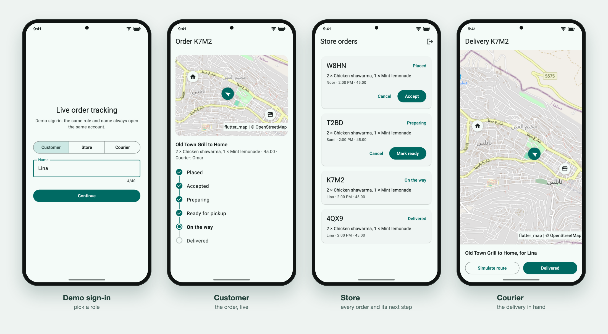

# Live order tracking

A small, complete example of the part of a delivery product I care most about getting right: the customer's phone, the store's screen and the courier's phone have to agree about one order, in real time, over connections that drop.

- [`api/`](api) — NestJS, PostgreSQL (Prisma), Socket.IO
- [`app/`](app) — Flutter with BLoC; one app, three roles (customer, store, courier)
- [`docs/api.md`](docs/api.md) — the contract both sides are written against



I build and run a delivery marketplace for a living. That code is private, so I wrote this repository from scratch to show how I approach the same problems, at a size you can read in one sitting.

## The flow

1. A customer places an order.
2. The store accepts it, prepares it and marks it ready.
3. A courier picks it up; the customer watches the courier move on the map.
4. The courier marks it delivered.

Everyone looking at the order sees each step the moment it happens.

## The problems this solves

**Two people act on the same order at once.** The store taps "Accept" while the customer taps "Cancel". Every order carries a `version`; a transition is a single `UPDATE … WHERE id = ? AND version = ?`, so exactly one of them wins. The other gets `409` with the order as it is now, and the app shows that instead of guessing.

**A tap is retried on a bad network.** Placing an order sends an `Idempotency-Key`. The app creates the key once per tap and reuses it for every retry of that tap, and the API has a unique index on `(customer, key)`, so a retry returns the first order instead of creating a second one.

**A phone goes offline for a minute.** Status changes are stored as a per-order log with a gapless sequence number. A client remembers the last `seq` it applied and sends it when it (re)subscribes; the server answers with a snapshot and everything it missed. If a live event ever arrives with a gap, the client fetches the missing range before applying anything newer. No "pull to refresh and hope".

**A courier sends positions faster than anyone needs them.** Positions are last-value-wins, so they are not part of the log. The API lets one position per order out per second, and always delivers the newest one at the end of a busy second, so the marker never stops short of where the courier really is.

**Who may do what.** The status machine is one table: from, to, role. The API enforces it. The app has the same table only to decide which buttons to show; if the two ever disagree, the API's answer is what the user sees.

## Run it

You need Node 22.12 or newer and Flutter 3.47 (stable). Docker is optional.

```bash
# API
cd api
npm install
npm run db:start        # local PostgreSQL without Docker; leave it running
# in a second terminal
cp .env.example .env
npm run start:dev
```

```bash
# App (iOS simulator)
cd app
flutter pub get
flutter run

# Android emulator reaches the host through 10.0.2.2
flutter run --dart-define=API_URL=http://10.0.2.2:3000
```

To see the whole flow on one machine, run the app three times (or sign out and back in): once as a customer, once as the store, once as a courier. The courier screen has a "Simulate route" button, so you do not have to walk anywhere.

## Tests

```bash
cd api && npm test && npm run test:e2e   # the e2e suite starts its own PostgreSQL
cd app && flutter analyze && flutter test

# with the API running: the app's data layer and tracking bloc against the real thing
cd app && flutter test test_live --dart-define=LIVE_API_URL=http://localhost:3000
```

The API's end-to-end tests go through HTTP and Socket.IO against a real PostgreSQL, including the race between two transitions and the replay after a reconnect. On the app side the tracking bloc is tested against a fake socket: duplicates, gaps, reordering, reconnects.

## What I left out on purpose

- **Real sign-in.** `POST /auth/demo-login` hands out a token for a name and a role. Everything behind it uses a normal JWT guard, so swapping the login is the only change.
- **More than one API instance.** Rooms and the position throttle live in memory. With several instances I would add the Socket.IO Redis adapter and move the throttle window to Redis.
- **Dispatch.** A courier picks an order from a list. Choosing the courier automatically is its own problem.
- **Payments and push notifications.** Both matter in a real product and neither would make this example clearer.

## License

MIT
